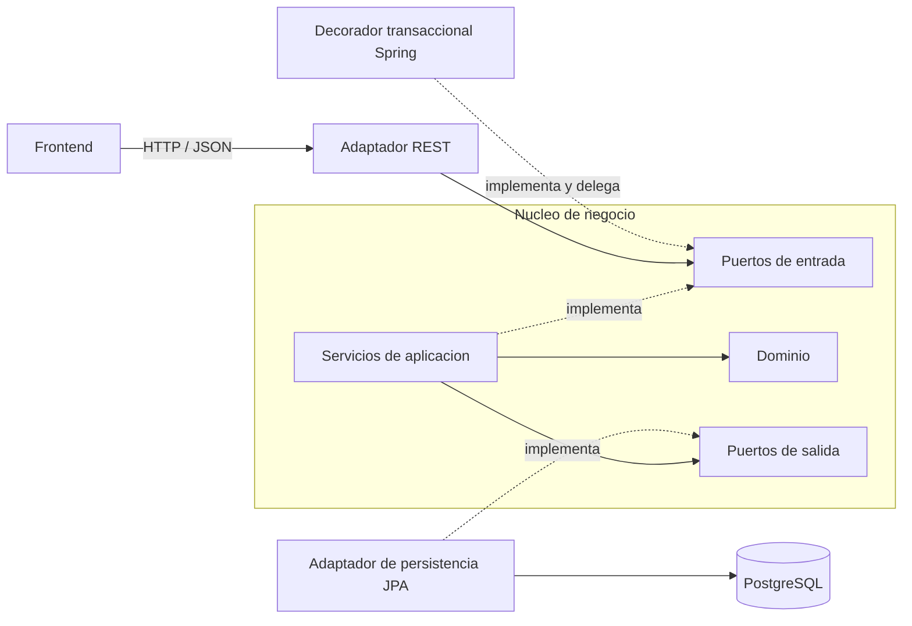

# Arquitectura y decisiones técnicas

Estado: propuesta para revisión. Java, Spring Boot, PostgreSQL, arquitectura hexagonal y el alcance funcional ya están aprobados; las elecciones de implementación de este documento se proponen para aprobación.

Base: [Requerimientos y reglas de negocio](01-requerimientos-y-reglas.md). Este documento define responsabilidades y dependencias; el siguiente avance detallará tablas, relaciones y restricciones. No contiene implementación.

## 1. Estructura y dirección de dependencias

Se propone un único backend desplegable, organizado por responsabilidades hexagonales y por funcionalidad dentro de ellas: clientes, cuentas y transacciones. Mantener estas operaciones en un proceso y una base de datos permite aplicar una transacción local a cada transferencia y facilita ejecutar la prueba técnica.

El dominio contiene las reglas financieras. La aplicación coordina casos de uso y define los puertos que necesita. Los adaptadores traducen HTTP y persistencia hacia esos contratos. Spring configura y conecta las implementaciones.

Las flechas continuas indican uso; las discontinuas, implementación de contratos. En ejecución, Spring conecta REST con el decorador transaccional de los casos de uso que modifican datos; este delega en el servicio de aplicación. El diagrama representa contratos y responsabilidades, no llamadas directas desde el dominio hacia PostgreSQL.

Reglas de dependencia propuestas:

- `domain` utiliza Java estándar y no importa Spring, JPA, DTO HTTP ni adaptadores.
- `application` depende de `domain` y de sus propios puertos; no importa controladores ni repositorios Spring Data.
- Los adaptadores dependen de los contratos del núcleo. Los puertos no exponen entidades JPA, tipos HTTP ni detalles de bloqueo SQL.
- `infrastructure/config` realiza la inyección por constructor y el ensamblaje. El frontend consume la API y nunca accede directamente a la base de datos.

## 2. Responsabilidades y correspondencia con el PDF

Los nombres siguientes son una organización propuesta de paquetes, no carpetas de aplicación creadas en este avance.

| Ubicación propuesta | Responsabilidad | Correspondencia con RNF-02 |
| --- | --- | --- |
| `domain/model` | Cliente, cuenta, transacción y movimiento; estados y valores monetarios. Preserva invariantes mediante operaciones explícitas. | Modelo de negocio separado de `entity` de persistencia. |
| `application/service` | Ejecutar casos de uso, consultar puertos, aplicar reglas y coordinar cambios. | `service`. |
| `application/port/in` | Contratos de los casos de uso y sus datos de entrada/salida independientes de HTTP. | Acceso a servicios mediante interfaces. |
| `application/port/out` | Contratos para guardar y consultar clientes, cuentas y operaciones; generación de número de cuenta. | Abstracciones de `repository` y servicios externos al núcleo. |
| `infrastructure/adapter/in/rest/controller` | Recibir solicitudes, validar su formato y mapear respuestas y errores. | `controller`. |
| `infrastructure/adapter/out/persistence/entity` | Representación JPA de los datos y relaciones. | `entity`. |
| `infrastructure/adapter/out/persistence/repository` | Repositorios Spring Data y adaptadores que implementan los puertos de salida. | `repository`. |
| `infrastructure/config` y `infrastructure/transaction` | Configuración de Spring y decoradores que delimitan las transacciones. | Soporte técnico de las capas. |

Las entidades JPA no se devuelven en la API. Se proponen mapeos explícitos entre DTO, comandos/resultados, dominio y persistencia, limitados a los campos necesarios. El coste de esos mapeos permite cambiar el esquema o el contrato REST sin introducir esos detalles en las reglas financieras.

## 3. Casos de uso, puertos y adaptadores

Los contratos se agrupan por capacidad coherente; sus nombres definitivos se establecerán al implementar. Ningún puerto de movimientos ofrecerá edición o eliminación de operaciones exitosas.

| Capacidad / puerto de entrada | Coordinación de aplicación y dominio | Puertos de salida necesarios | Trazabilidad |
| --- | --- | --- | --- |
| Crear, consultar, actualizar y eliminar clientes | Validar edad e identificación; impedir eliminación con cuentas vinculadas. | Clientes; consulta de cuentas por cliente. | RF-02, RN-01 a RN-03, P-01, P-02. |
| Crear y consultar cuentas | Verificar propietario existente, crear saldo cero, estado activo y número automático. | Clientes, cuentas y generador de número de cuenta. | RF-03, RF-04, RN-04, RN-06, P-03. |
| Actualizar atributos y cambiar estado de cuenta | Actualizar `exentaGmf`; activar, inactivar o cancelar respetando estado y saldo. | Cuentas. | RF-05, DA-03, P-05, P-06. |
| Consignar, retirar y transferir | Verificar importe, cuentas activas y fondos; actualizar saldos y registrar movimientos. | Cuentas y operaciones financieras. | RF-06, DA-02, DA-05. |
| Reversar una operación | Localizar original, impedir duplicados, compensar el total y conservar la trazabilidad. | Operaciones financieras y cuentas. | DA-01, P-04. |
| Consultar movimientos y estado de cuenta | Obtener saldo e historial coherentes de una cuenta. | Consultas de cuentas y operaciones financieras. | RF-07, P-05. |

El adaptador REST invoca los puertos de entrada. Los adaptadores JPA implementan los puertos de persistencia; sus consultas y bloqueos permanecen fuera del dominio. El generador produce números con el prefijo requerido y la base de datos garantiza su unicidad, incluso ante solicitudes concurrentes; el mecanismo se concretará con el modelo de datos.

Se inyectará `java.time.Clock` como dependencia estándar para calcular la fecha de Colombia (`America/Bogota`) y las fechas automáticas. Las pruebas podrán fijar el reloj sin depender del día real. No se necesita una interfaz propia que duplique `Clock`.

## 4. Operaciones financieras y consistencia

Se propone distinguir una **transacción financiera**, que identifica la operación, de sus **movimientos**, que representan débitos y créditos sobre cuentas. Una transferencia agrupa ambos movimientos; un reverso referencia la operación original completa. Esto permite revertir una transferencia como unidad y mantener el original inmutable (P-04).

El límite transaccional abarcará el caso de uso completo, desde la lectura protegida de las cuentas hasta la actualización de saldos y el registro de movimientos. Se propone un decorador Spring que implemente el puerto de entrada y delegue en el servicio Java; así, `@Transactional` queda fuera del núcleo. Se configurará rollback ante cualquier error que impida completar la operación. La llamada debe atravesar el bean transaccional y la respuesta exitosa solo se emite después del commit. Esta elección usa el mecanismo de proxies documentado por [Spring Framework](https://docs.spring.io/spring-framework/reference/data-access/transaction/declarative/annotations.html).

Flujo propuesto para una transferencia:

1. El controlador valida el formato de la solicitud y la convierte a datos del caso de uso.
2. El decorador inicia la transacción. El adaptador obtiene ambas cuentas con bloqueo de escritura y en orden estable por identificador.
3. El servicio comprueba existencia, cuentas distintas, estados activos, importe positivo y fondos suficientes; el dominio aplica débito y crédito.
4. Se guardan los saldos, la operación y sus movimientos dentro de la misma transacción.
5. Si falla una validación o escritura, se revierte la operación completa. Si confirma, se devuelve el resultado al cliente.

Se propone bloqueo pesimista por fila para serializar modificaciones de saldo sobre una misma cuenta. Todas las operaciones que cambien saldo o estado, incluidos reversos y cancelación, deben respetar la misma disciplina. Las actualizaciones de atributos también deben evitar sobrescribir un saldo leído antes de un movimiento concurrente. Los bloqueos se adquieren en un orden común para reducir interbloqueos y se mantienen durante una transacción corta; un conflicto no resuelto provoca rollback y una respuesta controlada. El soporte técnico se basa en [bloqueos de Spring Data JPA](https://docs.spring.io/spring-data/jpa/reference/jpa/locking.html) y [bloqueos por fila de PostgreSQL](https://www.postgresql.org/docs/current/explicit-locking.html).

Para reversos, se comprobará la operación original dentro de la misma transacción y una restricción de unicidad impedirá registrar dos reversos del mismo original. La lectura del estado de cuenta deberá obtener saldo e historial desde una vista consistente de los datos; el detalle se definirá junto con las consultas de persistencia.

ACID se refleja en: **atomicidad**, todos los efectos de la operación se confirman juntos; **consistencia**, reglas de dominio y restricciones de base de datos; **aislamiento**, protección de lecturas y escrituras concurrentes; **durabilidad**, persistencia tras el commit. No basta con añadir una anotación para demostrar estas propiedades: se validarán rollback, concurrencia y reversos con PostgreSQL real en pruebas de integración.

## 5. Tecnologías y decisiones

| Elección | Estado | Motivo y consecuencia |
| --- | --- | --- |
| Java, Spring Boot y PostgreSQL | Aprobada | Stack acordado; Spring en los adaptadores y configuración, reglas en Java. |
| JUnit 5, Mockito y pruebas de integración | Aprobada | Probar reglas y servicios desde desarrollo, además de controladores y persistencia. |
| Docker Compose para backend y PostgreSQL | Aprobada | Ejecución local reproducible; nube opcional. |
| Spring MVC y Bean Validation | Propuesta | Adaptador REST y validación de formato de entrada. Las reglas de negocio permanecen en el núcleo. |
| Spring Data JPA | Propuesta | Implementar persistencia y consultas; sus interfaces y anotaciones quedan dentro del adaptador. |
| Maven y su wrapper | Propuesta | Construcción y ejecución de pruebas con un comando reproducible. |
| Flyway con migraciones SQL versionadas | Propuesta | Evolución explícita del esquema y evidencia de DDL; los cambios de esquema no dependerán de generación automática de JPA. |
| Testcontainers con PostgreSQL | Propuesta | Validar restricciones, rollback y concurrencia con el mismo motor de persistencia; requiere Docker al ejecutar estas pruebas. |
| `BigDecimal`, COP y dos decimales | Aprobada | Representación monetaria acordada, sin cálculos de saldo con coma flotante binaria. |

Las versiones compatibles del JDK, Spring Boot y sus dependencias se fijarán al preparar la configuración, después de aprobar la documentación. El frontend funcional forma parte del alcance aprobado; su tecnología no modifica los contratos internos aquí definidos y se elegirá en el plan de implementación.

## 6. Validación, errores y principios de diseño

Los DTO REST validan forma y campos requeridos; el dominio y la aplicación garantizan edad, estados, importes, fondos e inmutabilidad aunque se invoquen sin HTTP. La base de datos refuerza unicidad y relaciones. Esta separación evita depender únicamente de validaciones del frontend.

Se propone una respuesta de error consistente con código estable y mensaje comprensible: formato inválido (`400`), recurso inexistente (`404`) y conflicto con reglas o estado actual (`409`). Un manejador REST traduce errores del núcleo y de infraestructura sin exponer SQL ni trazas. Los contratos concretos se desarrollarán con los casos de uso.

Patrones previstos: **puertos y adaptadores** para separar negocio y tecnología, **Repository** para persistencia, **Decorator** para transacciones e **inyección de dependencias** para conectar implementaciones y dobles de prueba. Se usarán donde exista esa responsabilidad, sin añadir patrones por cumplir una lista.

SOLID se aplica mediante responsabilidades separadas (SRP), adaptadores sustituibles sin cambiar reglas (OCP), implementaciones que respeten el contrato del puerto (LSP), interfaces limitadas a cada capacidad (ISP) y dependencias del núcleo hacia abstracciones (DIP).

La revisión de la implementación deberá comprobar: núcleo sin imports Spring/JPA, controladores sin acceso directo a repositorios, reglas comprobables con JUnit sin arrancar Spring y pruebas de integración de adaptadores y transacciones. La estrategia completa se documentará en el avance de pruebas y versionamiento.
