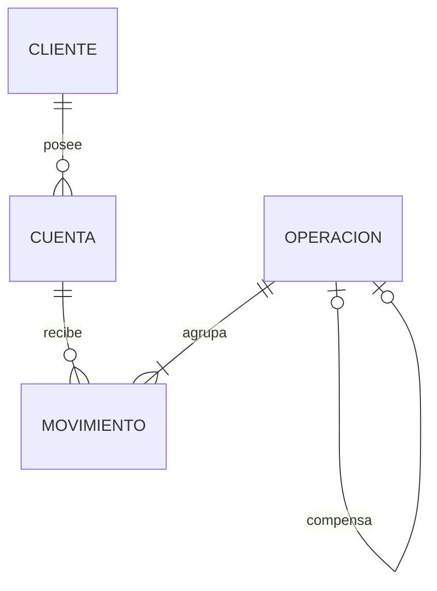

# Modelo de datos

Propuesta para revisión. El diseño traduce las [reglas de negocio](01-requerimientos-y-reglas.md) y el [límite transaccional de la arquitectura](02-arquitectura-y-decisiones.md) a cuatro tablas de PostgreSQL. La unidad que se confirma o revierte es la operación financiera completa.

## Relaciones

Una cuenta pertenece a un cliente. Cada movimiento identifica una cuenta y una operación. La relación opcional entre operaciones vincula un reverso con su original. Una operación original admite como máximo un reverso.

## Diccionario

| Tabla | Identidad y relaciones | Datos |
| --- | --- | --- |
| `cliente` | `id bigint` generado, clave primaria. Par único `(tipo_identificacion, numero_identificacion)`. | Tipo (CC, CE o pasaporte), número como texto para conservar ceros y letras, nombres, apellido, correo, fecha de nacimiento (`date`), creación y modificación. |
| `cuenta` | `id bigint` generado, clave primaria. `cliente_id` obligatorio referencia al propietario. `numero` de diez dígitos, único. | Tipo (ahorros o corriente), estado (activa, inactiva o cancelada), saldo, `exenta_gmf`, creación y modificación. |
| `operacion` | `id bigint` generado, clave primaria. `original_id` es una referencia opcional y única a otra operación. | Clase (consignación, retiro, transferencia o reverso), importe positivo en COP y fecha de registro. El reverso es el registro de la compensación aprobada en P-04. |
| `movimiento` | `id bigint` generado, clave primaria. `operacion_id` y `cuenta_id` son referencias obligatorias. Par único `(operacion_id, cuenta_id)`. | Sentido (débito o crédito). El importe y la fecha se leen de la operación, comunes a todos sus movimientos. |

Se proponen campos obligatorios salvo `original_id` y la fecha de modificación, que se completa al producirse el primer cambio. Las fechas de auditoría usan `timestamptz`. La edad se calcula con la fecha civil de Colombia al registrar o modificar el cliente. Los importes y saldos usan `numeric(19,2)`, correspondiente a `BigDecimal` en Java. La precisión total de 19 dígitos es una elección de diseño. El saldo disponible se obtiene del saldo actual mientras no haya retenciones (DA-02).

## Restricciones y responsabilidad

| Regla | Garantía propuesta |
| --- | --- |
| Identidad y edad (P-01, P-02) | PostgreSQL restringe los tipos admitidos y la unicidad del par tipo/número. El dominio valida edad, correo y longitud de nombres. Para impedir que una escritura directa inserte un menor, se propone validar también la fecha de nacimiento en la base al insertar o actualizar la fila, con la fecha de `America/Bogota`. |
| Alta de cuenta (RN-06, P-03, P-06) | Una secuencia por tipo genera el sufijo de ocho dígitos, completado con ceros. La secuencia se limita a ocho dígitos y no se recicla. Una restricción comprueba longitud, caracteres y prefijo (`53` ahorros, `33` corriente). La cuenta nace activa, con saldo cero y `exenta_gmf=false`. |
| Propiedad y cancelación (RN-02, P-05) | Claves foráneas con eliminación restringida protegen clientes con cuentas y cuentas con movimientos. La aplicación conserva propietario, tipo y número, y cancela por cambio de estado. Se exige saldo no negativo y saldo cero para el estado cancelado. Una cuenta cancelada permanece vinculada al cliente. |
| Movimiento y reverso (P-04) | La clase reverso exige `original_id`; las demás clases lo dejan vacío. Se impide la autorreferencia y la unicidad protege contra reversos simultáneos. El servicio verifica original, importe total y cuentas activas con fondos suficientes. El rol de ejecución solo necesita lectura e inserción sobre el historial. |
| Composición de la operación (RF-06) | El servicio registra un crédito por consignación, un débito por retiro y dos movimientos en cuentas distintas por transferencia. Para un reverso registra las mismas cuentas y el importe original con sentidos opuestos. La cardinalidad y la correspondencia entre filas se validan dentro de la transacción. |

## Saldos, concurrencia y consultas

El saldo de la cuenta materializa el resultado de sus movimientos para consultar fondos y autorizar débitos. Como todas las cuentas parten de cero, debe coincidir con la suma de créditos menos débitos. La cuenta y su historial se escriben dentro de la misma transacción.

Por ejemplo, con A en 100,00 COP y B en 20,00 COP, una transferencia de 30,00 COP registra una operación, un débito en A y un crédito en B. Al confirmar, los saldos son 70,00 y 50,00 COP. Si falla la escritura del crédito, se revierte también el débito y ambas cuentas conservan los saldos iniciales. Un reverso posterior referencia esa transferencia, genera los movimientos opuestos y requiere que B aún disponga de 30,00 COP.

Para transferir o reversar, el servicio bloquea las cuentas en orden de identificador, vuelve a comprobar estados y fondos con el bloqueo adquirido y confirma saldos y movimientos juntos. Un retiro o cambio de estado sobre esas cuentas sigue el mismo criterio. Si dos retiros concurrentes solicitan 80,00 COP sobre una cuenta con 100,00 COP, solo uno puede confirmarse.

Para el estado de cuenta se propone leer el saldo y el historial desde la misma instantánea. La consulta debe devolver también cuentas sin movimientos. El historial se ordena por fecha de operación y usa el identificador de movimiento como desempate. Además de los índices de claves primarias y únicas, se proponen índices en `cuenta(cliente_id)` y `movimiento(cuenta_id, operacion_id)` para las consultas por cliente y cuenta.
