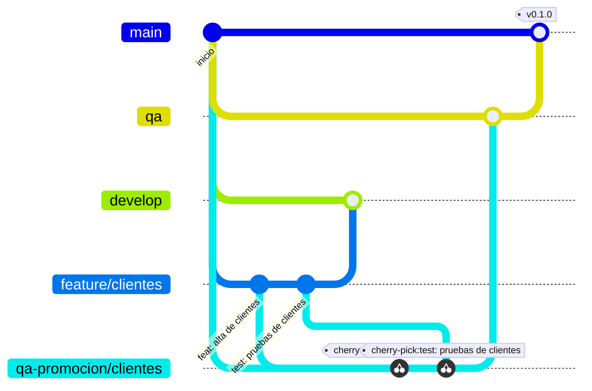

# Pruebas y versionamiento Git

Estado: aprobado. Cada incremento del [plan de implementación](04-plan-de-implementacion.md) entrega la funcionalidad y sus pruebas desde su rama `feature/*`. Los criterios que se citan a continuación están definidos en [requerimientos y reglas](01-requerimientos-y-reglas.md).

## Qué probar

| Nivel | Casos prioritarios | Evidencia esperada |
| --- | --- | --- |
| Dominio y servicios | Edad con reloj fijo de Colombia, combinación tipo/número, transiciones de cuenta, importes, fondos y condiciones de reverso. | JUnit 5 prueba el dominio directamente. En servicios, Mockito sustituye los puertos de salida y permite verificar que un rechazo evita escrituras. |
| Controladores REST | Solicitud válida, formato inválido, recurso inexistente y conflicto de negocio. | Pruebas de controlador con el puerto de entrada simulado. Comprobar estado HTTP, respuesta y conversión de datos según el contrato. |
| Integración con PostgreSQL | Migraciones desde una base vacía, claves foráneas, unicidad, precisión monetaria, consultas, rollback y concurrencia. | Ejecutar contra PostgreSQL real en un entorno aislado. Se usa Testcontainers conforme a la [arquitectura](02-arquitectura-y-decisiones.md). |
| Componentes del frontend | Formularios de cliente, apertura y operaciones; tabla del estado de cuenta; presentación de errores `400`/`409` del [contrato REST](07-contrato-api-rest.md). | Vitest y React Testing Library renderizan cada componente con la API simulada y comprueban lo que ve y hace el usuario, no detalles internos. |
| Recorrido funcional | Alta de cliente, apertura, consignación, transferencia, reverso y consulta del historial desde el frontend. | Con el backend y PostgreSQL en Compose, registrar datos de prueba, saldos obtenidos y resultado del recorrido (CA-15). |

## Casos que requieren la base de datos

| Escenario | Cómo verificarlo |
| --- | --- |
| Transferencia interrumpida (CA-07) | Provocar un fallo de escritura después del débito. Al terminar, consultar desde otra transacción y comprobar que ambos saldos y el historial coinciden con el estado previo. |
| Dos retiros sobre la misma cuenta (CA-06) | Con saldo de 100,00 COP, lanzar dos retiros de 80,00 en transacciones independientes coordinadas para competir por la cuenta. Debe confirmarse uno, quedar 20,00 y registrarse un solo débito. |
| Reversos concurrentes (CA-09) | Solicitar dos reversos del mismo original. Verificar un único reverso total vinculado al original, las dos compensaciones si era una transferencia y la conservación del historial original. |
| Integridad y consulta (CA-03, CA-11, CA-13) | Intentar repetir una identificación y eliminar un propietario con cuenta vinculada. Consultar además una cuenta vacía y otra con movimientos para contrastar saldo e historial. |

Preparar datos independientes por caso y controlar el inicio de operaciones concurrentes con sincronización explícita. Los saldos, el número de movimientos y los vínculos al original se verifican después de la confirmación o rollback. El fundamento está en el [modelo de datos](03-modelo-de-datos.md) y el [ADR de consistencia](adr/002-consistencia-de-movimientos.md).

## Evidencia para revisión

Cada PR de funcionalidad identifica el commit probado, los criterios cubiertos, el comando ejecutado, el entorno y el resultado real. Un fallo incluye el escenario reproducible y su efecto. Si se mide cobertura, se informa la medición para servicios y controladores junto con los comportamientos comprobados. Los cambios solo documentales se validan mediante diff, enlaces, formato y coherencia de las referencias.

## Flujo de ramas

Tres ramas permanentes: `develop` (integración), `qa` (validación) y `main` (versiones entregadas). Ninguna recibe commits directos: todo entra por pull request.

**Relación con git flow.** El flujo se basa en git flow: ramas permanentes de integración (`develop`) y de versiones publicadas (`main`), ramas temporales por funcionalidad que salen de `develop` y vuelven a ella mediante PR, y versiones identificadas con tags semánticos en `main`. Se adapta en dos puntos de forma deliberada:

1. **Rama permanente `qa`.** Representa el entorno de validación entre integración y entrega, en lugar de validar sobre ramas `release/*` temporales. Así queda siempre visible qué versión está en pruebas, y `main` solo recibe lo que ya pasó por `qa`.
2. **Promoción selectiva con `git cherry-pick -x`.** En lugar de llevar todo `develop` a una release, se eligen los commits ya integrados y probados que deben validarse. Esto permite promocionar una funcionalidad terminada aunque otra siga en curso en `develop`, y la opción `-x` registra en cada commit el SHA de origen para conservar la trazabilidad.

| Rama | Sale de | PR hacia | Uso |
| --- | --- | --- | --- |
| `feature/<tema>` | `develop` | `develop` | Una funcionalidad o etapa del [plan](04-plan-de-implementacion.md) con sus pruebas (CA-16). Ejemplos: `feature/clientes`, `feature/transferencias`. |
| `docs/<tema>` | `develop` | `develop` | Cambios solo de documentación. |
| `qa-promocion/<tema>` | `qa` | `qa` | Recibe por cherry-pick los commits ya integrados en `develop` que se van a validar. |
| `qa` | — | `main` | Una vez validada, se integra en `main` por PR. |

El prefijo `qa/<tema>` no es posible porque la rama `qa` ya ocupa ese nombre en Git; por eso se usa `qa-promocion/<tema>`.

### 1. Desarrollo hacia `develop`

1. Actualizar `develop` y crear `feature/<tema>`.
2. Implementar la funcionalidad junto con sus pruebas unitarias, de integración y de componentes, y ejecutarlas en la propia rama.
3. Abrir PR hacia `develop` con los criterios cubiertos y el resultado real de las pruebas. Integrar con merge commit para que los commits de trabajo se conserven y puedan seleccionarse después.

### 2. Promoción a `qa`

1. Actualizar `qa` desde `origin/qa` y crear `qa-promocion/<tema>`.
2. Identificar en `develop` los commits que se promocionan (incluidas sus pruebas y dependencias) y aplicarlos en orden con `git cherry-pick -x <sha>`. La opción `-x` añade al mensaje el SHA de origen y deja la trazabilidad en el historial. No se seleccionan los merge commits, solo los commits de trabajo.
3. Ejecutar en esa rama todas las pruebas, la regresión y los criterios de aceptación de lo promocionado.
4. Abrir PR hacia `qa` con la lista de commits promocionados (SHA en `develop` → SHA en `qa`) y los resultados.
5. Si una prueba falla, no se corrige en la rama de QA: se detiene la promoción, la corrección se hace en una nueva `feature/*` desde `develop` y luego se promociona con el mismo procedimiento.

### 3. Publicación en `main`

Con `qa` validada, abrir PR de `qa` hacia `main`. Tras el merge se crea el tag de versión semántica (`v0.1.0` por hito, `v1.0.0` para la entrega completa) y esa versión es la que se despliega en [EC2](08-despliegue-en-aws-ec2.md). Como `main` solo recibe desde `qa`, todo lo publicado pasó antes por validación.

### Reglas comunes

- Mensajes con [Conventional Commits](https://www.conventionalcommits.org/es/v1.0.0/) (`feat:`, `fix:`, `docs:`, `test:`, `chore:`, `refactor:`).
- Antes de cada cherry-pick, comprobar que el cambio no está ya en `qa` para no duplicarlo.
- Las ramas temporales se eliminan tras su merge. No se usa `push --force` sobre ramas compartidas.
- En GitHub, `develop`, `qa` y `main` se protegen para exigir PR y bloquear push forzado y borrado. La rama por defecto es `develop` mientras `main` no tenga la primera versión.
