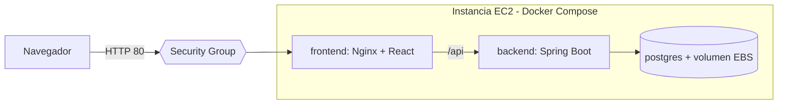

# Despliegue en AWS EC2

Propuesta para revisión. Responde al requisito del PDF sobre servicios de nube utilizados. La aplicación se ejecuta en una instancia **Amazon EC2** con el mismo Docker Compose del entorno local, de modo que lo evaluado en local y en la nube es la misma configuración.

## Arquitectura

Solo Nginx publica un puerto. El backend y PostgreSQL quedan en la red interna de Compose y no son accesibles desde Internet.

## Recursos de AWS

| Servicio | Configuración propuesta | Motivo |
| --- | --- | --- |
| EC2 | `t3.small` (2 GB RAM) con Ubuntu Server 24.04 LTS. | Spring Boot, PostgreSQL y Nginx juntos necesitan más de 1 GB. Una `t2.micro`/`t3.micro` de capa gratuita solo es viable con swap y límites de memoria en la JVM. |
| EBS | Volumen gp3 de 20 GB. | Sistema, imágenes Docker y el volumen de datos de PostgreSQL. |
| Security Group | Entrada `80/tcp` desde cualquier origen y `22/tcp` solo desde la IP del responsable. Sin reglas para `5432` ni `8080`. | Exponer únicamente la interfaz y limitar la administración. |
| Elastic IP | Una dirección asociada a la instancia. | URL estable para la entrega aunque la instancia se reinicie. |
| Par de claves | Clave SSH creada en AWS y guardada fuera del repositorio. | Acceso administrativo. |

Fuera del alcance: dominio propio, HTTPS, RDS, balanceador y CI/CD. Se citan como mejoras posibles en la sección final.

## Procedimiento

1. Crear la instancia con el Security Group, la Elastic IP y el par de claves anteriores.
2. Conectarse por SSH e instalar Docker Engine y el plugin Compose desde el repositorio oficial de Docker.
3. Clonar el repositorio y situarse en el tag de la versión publicada en `main` (por ejemplo `v1.0.0`).
4. Crear `.env` en la instancia a partir de `.env.example` con la contraseña de PostgreSQL y el perfil de Spring (`prod`, o `prod,demo` para cargar datos de ejemplo). `.env` está en `.gitignore`.
5. Ejecutar `docker compose up -d --build`. Flyway aplica las migraciones al arrancar el backend.
6. Verificar `docker compose ps`, el endpoint de salud del backend (`/actuator/health`) a través de Nginx y el recorrido funcional desde el navegador con la Elastic IP.

Actualizar a una nueva versión: `git fetch --tags`, `git checkout <tag>` y repetir el paso 5. El volumen de PostgreSQL conserva los datos.

## Configuración y seguridad

- Ninguna credencial se versiona; `.env.example` documenta las variables sin valores reales.
- Los contenedores usan `restart: unless-stopped` para recuperarse tras un reinicio de la instancia.
- La JVM se limita con `-XX:MaxRAMPercentage` y cada servicio con `mem_limit` para evitar que un servicio agote la memoria de la instancia.
- Copia de seguridad manual antes de cada actualización: `docker compose exec postgres pg_dump` hacia un archivo en la instancia, o una instantánea del volumen EBS.

## Evidencia para la entrega

El README final incluirá la URL pública, el tag desplegado, la fecha del despliegue y capturas del recorrido. Para controlar costes, la instancia puede detenerse después de la evaluación; la Elastic IP debe liberarse si la instancia se elimina, porque una IP sin asociar tiene coste.

## Mejoras posibles

RDS para PostgreSQL gestionado con copias automáticas, HTTPS con un dominio y certificado, imágenes publicadas en Amazon ECR y despliegue automático con GitHub Actions al crear un tag en `main`.
